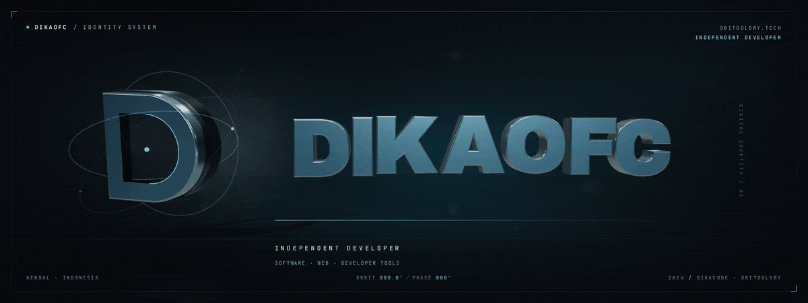
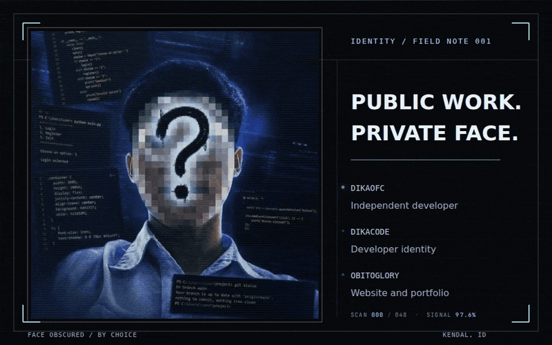
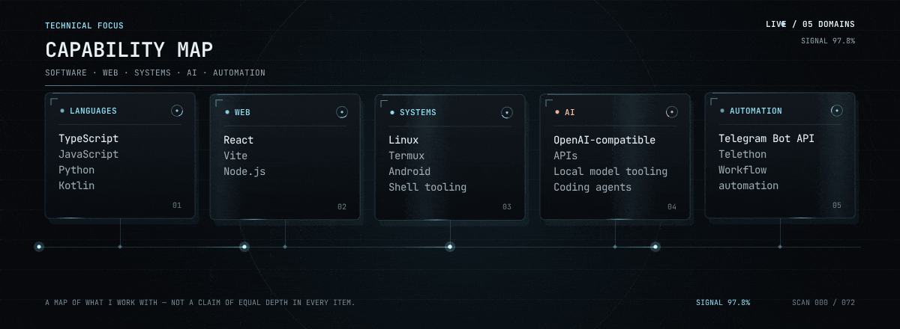
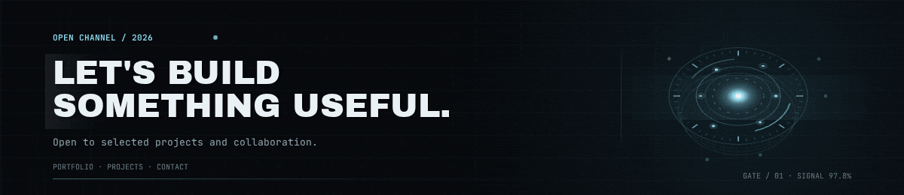

<!--
  Primary identity: DikaOfc
  Supporting identities: DikaCode (developer identity), ObitoGlory (website / portfolio brand)
  Asset pipeline and source notes: docs/ASSET-GUIDE.md
-->

  

<a href="assets/dikaofc-hero.png">View static hero poster</a>

<h1 align="center">DikaOfc</h1>

  <strong>Independent developer</strong> · DikaCode · ObitoGlory

  <a href="https://www.obitoglory.tech/">Portfolio</a> ·
  <a href="https://www.obitoglory.tech/proyek">Projects</a> ·
  <a href="https://dikaglorya.github.io/journal/">Journal</a> ·
  <a href="https://www.obitoglory.tech/tentang">About</a> ·
  <a href="https://www.obitoglory.tech/kontak">Contact</a>

---

I build software, web experiences, and practical developer tools from Kendal, Central Java, Indonesia.

DikaOfc is my public identity. I also work as **DikaCode**, while **ObitoGlory** is my website and portfolio brand. Older links may use **DikaGlory** or **DikaGlorya**. This GitHub profile — **dikaglorya** — is the only GitHub account I publish from.

  

<a href="assets/dikaofc-identity.png">View static identity panel</a>

## Technical focus

  

Languages · Web · Systems · AI · Automation — a map of what I work with, not a claim of equal depth in every item.

## Current focus

- Building practical tools around AI routing, terminal workflows, and automation.
- Exploring local-first AI tooling and Android / Termux.
- Improving performance, documentation, and maintainability in the tools I build.

## Engineering principles

- Build useful things.
- Prefer maintainable solutions.
- Measure rather than fabricate performance claims.
- Document important decisions.
- Keep interfaces accessible.
- Improve through feedback.

## Contact

  

Open to selected projects and collaboration. Explore the [portfolio and case studies](https://www.obitoglory.tech/proyek), or reach me directly on [Telegram](https://t.me/dikaacode). This is my only GitHub profile: [@dikaglorya](https://github.com/dikaglorya).

---

  Building useful software, one project at a time.

