  <picture>
    <source media="(prefers-color-scheme: dark)" srcset="assets/hero-dark.svg">
    
  </picture>

  
  
<strong>dikaofc</strong> · he/him · Kendal

  
I'm DikaCode / ObitoGlory / DikaOfc · EXECUIDOR

  

<picture>
  <source media="(prefers-color-scheme: dark)" srcset="assets/divider.svg">
  
</picture>

## About

  <picture>
    <source media="(prefers-color-scheme: dark)" srcset="assets/about-3d.svg">
    
  </picture>

<picture>
  <source media="(prefers-color-scheme: dark)" srcset="assets/divider.svg">
  
</picture>

## Skills

  <picture>
    <source media="(prefers-color-scheme: dark)" srcset="assets/skills-3d.svg">
    
  </picture>

<picture>
  <source media="(prefers-color-scheme: dark)" srcset="assets/divider.svg">
  
</picture>

## GitHub Stats

  <picture>
    <source media="(prefers-color-scheme: dark)" srcset="assets/stats-3d.svg">
    
  </picture>
  <picture>
    <source media="(prefers-color-scheme: dark)" srcset="https://github-readme-stats.vercel.app/api?username=dikaglorya&show_icons=true&theme=tokyonight&hide_border=true">
    
  </picture>
  <picture>
    <source media="(prefers-color-scheme: dark)" srcset="https://github-readme-streak-stats.herokuapp.com/?user=dikaglorya&theme=tokyonight&hide_border=true">
    
  </picture>
  <picture>
    <source media="(prefers-color-scheme: dark)" srcset="https://github-readme-stats.vercel.app/api/top-langs/?username=dikaglorya&layout=compact&theme=tokyonight&hide_border=true">
    
  </picture>

  <picture>
    <source media="(prefers-color-scheme: dark)" srcset="https://raw.githubusercontent.com/dikaglorya/dikaglorya/output/github-contribution-grid-snake-dark.svg">
    
  </picture>

<picture>
  <source media="(prefers-color-scheme: dark)" srcset="assets/divider.svg">
  
</picture>

## Connect

  
  
  
  
  
  
  
  <a href="https://www.obitoglory.tech/layanan">Open Jasa, Digital Solution</a>

  <picture>
    <source media="(prefers-color-scheme: dark)" srcset="assets/footer-dark.svg">
    
  </picture>

